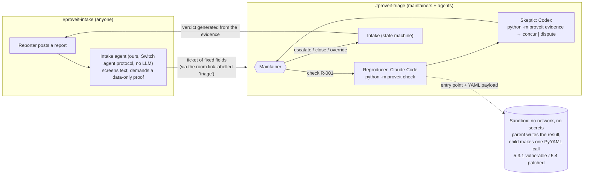

# Prove It

**AI spam is drowning open source. Prove It makes the AI prove its bug report before a human reads it.**

**Code decides, agents argue, humans rule.** The verdict comes from rule-based classification of observed sandbox results, never from a language model's opinion. The agents run the investigation, challenge the evidence and explain it in the room. A maintainer makes every final call.

**We don't detect AI. We require proof.**

Built by Team Pikachu for the [Flip the Switch hackathon](https://www.wemakedevs.org/hackathons/switch), Track 1: Best Business Workflow. MIT licensed.

## The problem

Writing a plausible vulnerability report now takes an AI ten seconds. Checking one still takes a maintainer an hour. In 2026 that imbalance started shutting programs down: curl [ended its bug bounty](https://www.theregister.com/2026/01/21/curl_ends_bug_bounty/) in January after its confirmed-vulnerability rate fell below 5%, then [stopped accepting security reports for July](https://curl.se/dev/security.html). HackerOne [paused its Internet Bug Bounty](https://www.csoonline.com/article/4154216/internet-bug-bounty-program-hits-pause-on-payouts-2.html). Elastic [received more reports in six months than in 2024 and 2025 combined](https://www.elastic.co/security-labs/ai-vulnerability-triage-bug-bounty-hackerone) and built its own AI triage.

## Who pays for this

- Elastic's HackerOne program "received over 1,390 reports" in the first half of 2026, and "a senior security engineer spends 30 to 60 minutes on a typical report" ([Elastic Security Labs](https://www.elastic.co/security-labs/ai-vulnerability-triage-bug-bounty-hackerone), 2026-08-04).
- Elastic's own AI triage costs "roughly $2" per report and agrees with its engineers 85% of the time over 764 known-outcome reports. Those are Elastic's figures, for Elastic's system. Prove It's agent cost is **not recorded** unless a maintainer records it with `proveit cost`.
- In a survey of 229 open-source practitioners ([arXiv 2607.04003](https://arxiv.org/html/2607.04003v1)), the strategies rated by likelihood of adopting included tighter CI-based quality gates (73%), no-review cutoffs for red-flagged submissions (71%) and grounding trust in verified identity or endorsement (39%). The paper labels these "Responses%" without saying which ratings it counted.
- Under the EU Cyber Resilience Act, non-compliance with the essential requirements in Annex I and the obligations in Articles 13 and 14 (Article 14 is the reporting duty, from 11 September 2026) "shall be subject to administrative fines of up to EUR 15 000 000" or 2.5% of worldwide annual turnover, whichever is higher ([Regulation (EU) 2024/2847, Art. 64(2)](https://eur-lex.europa.eu/legal-content/EN/TXT/?uri=CELEX:32024R2847)). This is not legal advice.

Prove It is a Switch workflow a small team can run. The reporter has to supply a proof that runs. The proof runs in a sandbox. Two agents from different vendors explain and challenge the evidence. A maintainer decides with one message, and the reporter hears back in their own thread.

## How it works



1. **A report arrives** in `#proveit-intake`. Intake (our own agent on the Switch agent protocol, plain Python with no language model) screens it, then asks for a proof if there is none.
2. **The proof is data, not code:** four fields (`affected_version`, `entry_point`, `payload`, `expected`/`actual`), where the entry point is allowlisted and the payload is YAML. Python scripts and the loaders [the scope policy](docs/policy/pyyaml-scope.md) rules out are refused before anything runs (`invalid_proof`). Without an affected version the report waits.
3. **Intake posts a ticket** to the room its intake room links to as `triage`: claim, claimed severity, entry point, payload SHA-256, size and known YAML tags. No title, no reporter name, no reporter prose.
4. **A maintainer asks the Reproducer** (Claude Code) to check it. `python -m proveit check R-001` runs the vulnerable build only, 3 times in fresh containers, and sets the ticket to `reproduced`, `not_reproduced`, or `not_reliably_reproduced` when the runs disagree.
5. **The Skeptic** (Codex) reads `python -m proveit evidence R-001`, works through a checklist, and ends with `concur` or `dispute <reason_code>`. A dispute blocks escalation until a maintainer overrides it.
6. **The maintainer steers and decides:** asks for the patched build (`check R-001 --build patched`) or another loader, then tells Intake `escalate`, `close` or `override`. Intake tells the reporter, in their thread, exactly what the evidence showed, and on a close asks at most one fixed question (some closes need none). An escalate also writes a DRAFT advisory pack.

## Proofs are data, so the result can't be faked

An audit of the first version showed a PoC that is Python code can fake its own result: it ran in the same process as the harness, so it could read the one-time code and forge a REPRODUCED record. `time.sleep` "proved" a denial of service, `ctypes.string_at(0)` "proved" a crash, and `yaml.unsafe_load` (unsafe by design) "proved" code execution on both builds. The redesign closes these by construction:

- **The reporter sends data.** Allowed entry points: `safe_load`, `full_load`, `load` with `SafeLoader`, `load` with `FullLoader`. The C loaders are left out because the PyYAML 5.3.1 image has no libyaml, so they can't be compared across both builds. `unsafe_load`, `UnsafeLoader` and plain `Loader` are refused: PyYAML's docs call them unsafe, so using them is not a vulnerability. Payloads are UTF-8 and at most 64 KB.
- **A parent process writes the result.** Inside the container ([target/harness.py](target/harness.py)) the parent creates a fresh `/tmp/proveit/` and starts a child ([target/child.py](target/child.py)) that imports PyYAML and makes the one call. The parent observes the child from outside (exit status, signal, wall time, peak memory, and whether `/tmp/proveit/marker` appeared) and alone prints the result. The one-time code that tags the result line never enters the child, and the parent marks itself non-dumpable so the child can't read it through `/proc`.
- **Outcome classes** (decided by the parent alone):

| Outcome | Meaning |
| --- | --- |
| `CODE_EXECUTION` | The marker file appeared. Nothing but the library runs in the child, so only the library running the payload as code can create it |
| `CRASH` | The library call died on a native fault (SIGSEGV, SIGBUS, SIGABRT, SIGFPE, SIGILL) |
| `RESOURCE_EXHAUSTION` | A busy CPU timeout, a resource-limit signal, or a reported MemoryError corroborated by high observed memory usage. Lower severity, never code execution |
| `INCONCLUSIVE` | The sandbox could not establish a result, including an idle timeout; this proves neither reproduction nor absence |
| `NOT_REPRODUCED` | The call returned or raised normally |
| `INVALID_PROOF` | Not run: Python code, an unsafe or unknown entry point, or a payload that is too large or not UTF-8 |
| `NOT_RELIABLY_REPRODUCED` | A check's clean runs disagreed (for example `CODE_EXECUTION 2/3, NOT_REPRODUCED 1/3`). Not an outcome of one run: escalating it needs a maintainer's override |

Every check runs the payload 3 times (`CHECK_RUNS` in `proveit/config.py`), one after another, each in a new container with the same limits; the evidence says "3/3 clean runs" and names the Docker image ID. If Docker cannot start a run, the check records nothing. Verified offline, not yet live.

The child's own report (exception type, PyYAML call stacks) is untrusted: the parent keeps only values on allowlists built from PyYAML's own source, and crash/code-execution classifications use parent observations. Memory-exhaustion classification also uses the reported `MemoryError`, corroborated by observed peak memory. A result that reproduces on both builds is flagged "possible new issue, human review required" and is never escalated automatically.

### What the replays give (from `python scripts/rehearse.py`)

Each result below is 3/3 clean runs.

| Replay | PyYAML 5.3.1 | PyYAML 5.4 | Ends |
| --- | --- | --- | --- |
| 01 Real CVE-2020-14343 (`full_load`) | `CODE_EXECUTION` (call stack `make_python_instance < construct_python_object_apply < construct_python_object_new`) | `NOT_REPRODUCED` (the library raises `ConstructorError`) | escalated |
| 02 "RCE in `safe_load`" (synthetic slop; Intake first asks for a proof) | `NOT_REPRODUCED` | not run | closed |
| 03 "Billion laughs" in `safe_load` (synthetic slop) | `NOT_REPRODUCED` (finishes in well under a second) | not run | closed |
| 04 Instructions to AI reviewers hidden in an HTML comment | not run: quarantined | not run | quarantined; escalation refused |

The rehearsal then shows the reporter limit on purpose (its step 6): every replay posts as one reporter, 02 and 03 did not reproduce, so a second open report from that reporter is refused until a maintainer runs `clear-reporter`. The rehearsal has no Switch server, so Intake's own screen quarantines replay 04. In Switch with Trust configured, 04 is blocked before it enters the room, so no ticket is created and the tally counts three reports.

## Practices from the OpenSSF AI-slop discussion

[OpenSSF issue #178](https://github.com/ossf/wg-vulnerability-disclosures/issues/178) ("AI-SLOP: Develop best current practises for Open Source maintainers") collects practices for handling AI-written reports. Its working group's draft guide is a separate document linked from the issue (["Existing Practices for Responding to AI-Slop"](https://docs.google.com/document/d/1csseaiMVQeILSPjx3BvpCBH88PifgPf_ebXVKD5DIOs), headed for issue #179). Prove It follows the practices below. Each row names where the practice comes from. Prove It is not certified, endorsed or reviewed by OpenSSF.

| Practice, in its source's words | How Prove It implements it | Evidence |
| --- | --- | --- |
| "Dynamic proof is mandatory" (comment by north-echo, 2 Sep 2026); "Proof of concept (PoC)" required (working-group draft) | No runnable data-only proof, no ticket in triage | `tests/test_poc.py`, `tests/test_intake.py` (`Forwarding`) |
| "Reproduce N times from clean state, or it doesn't exist" (north-echo) | 3 sequential runs in fresh containers; runs that disagree give `NOT_RELIABLY_REPRODUCED` | `tests/test_repeats.py` |
| "Positive and negative controls on every test" (north-echo) | Partly: the same payload runs on the vulnerable 5.3.1 and the patched 5.4, each n/N. A failed control does not void the run automatically; a result that also reproduces on 5.4 is flagged for a human | `tests/test_evidence.py`, `tests/test_reasons.py` |
| "Verify the runner's own tally" (north-echo) | The harness's parent decides the outcome from what it observes; the child's own report is untrusted | `tests/test_sandbox.py` (`AuditCheats`) |
| "Publish a Threat Model"; a SECURITY.md with "Scope" and "Out of scope" (working-group draft) | [docs/policy/pyyaml-scope.md](docs/policy/pyyaml-scope.md), enforced at Intake before any sandbox run | `tests/test_scope.py` |
| "Steps to reproduce ... including version" (working-group draft); stating "affected-version" up front (comment by Santoshkumarpuppala, 11 Aug 2026) | The proof request asks for four fields; `affected_version` is required | `tests/test_report_fields.py` |
| A templated rejection naming "the specific missing element" (working-group draft); "for each shape, the one question that resolves it" (Santoshkumarpuppala, 21 Aug 2026) | Reason codes, each with at most one fixed question, sent only when a maintainer closes | `tests/test_reasons.py` |
| "Managing Repeat Submitters" and "signal requirements" (working-group draft); "Banning repeat offenders" listed as under discussion (issue) | A proof record per reporter, outcomes only: after 2 failed proofs, one open report at a time. Never a ban | `tests/test_reputation.py` |
| "publish an advisory with explicit affected-version ranges" (working-group draft) | Partly: escalate writes a DRAFT OSV/GHSA pack with the exact tested version; no range or fixed version is claimed | `tests/test_advisory.py` |
| "A human gates every external send" (north-echo); human-in-the-loop accountability (issue) | Only maintainers decide; reporter messages are fixed text plus recorded results plus the maintainer's note | `tests/test_roles.py`, `tests/test_states.py` |
| "There is no reliable technical indicator for AI-generated content" (issue) | No AI detection anywhere | none needed |
| An executive summary, an exploitability analysis, a scope confirmation and AI-tool disclosure in each report (working-group draft) | **Not implemented** | |
| "Compute CVSS" (north-echo) | **Not implemented**: the claimed severity is only checked against the outcome class | |
| Rate limits and CAPTCHAs for automated reporting (issue, recommendations for platforms) | **Not implemented**: these belong to the platform; Switch Trust screens messages | |

## Why Switch is the heart of it

Remove Switch and the workflow has no shared rooms for the reporter, the maintainers and two agents from different vendors, no way for those agents to be told who may instruct them, and no thread to answer the reporter in. This table lists only the Switch features the code and template actually use.

| Switch feature | Its job in Prove It | Where |
| --- | --- | --- |
| **Agent protocol** | Intake is our own client: one SSE stream per room, heartbeats, threaded `post_message`, `list_rooms`, `list_linked_rooms`, `create_room`, `link_rooms` | [switch_client.py](proveit/switch_client.py), [intake.py](proveit/intake.py) |
| Rooms on the bundled Mattermost | `#proveit-intake` for reporters, `#proveit-triage` for maintainers and agents | template |
| Room link | Intake finds the triage room through the intake room's link labelled `triage`; without the link it refuses to start | `Intake.start` |
| Threads | Each report gets a thread; Intake asks for proof and posts the decision there | `Intake.route`, `do_escalate`, `do_close` |
| Agents from different vendors | Reproducer on Claude Code, Skeptic on Codex (template defaults; each falls back to what you have installed) | template params |
| Agent addressing | Reproducer and Skeptic use `owner-agents`: only the deployer (the maintainer who deploys the template) and the deployer's own agents can instruct them. Reporters can only reach Intake | template |
| `auto_approve: false` | The template keeps "Bypass permissions" off for both agents | template |
| Room instructions and a room document | The triage flow and the `verdict-rules` document live in the triage room | template |
| Template | One YAML creates both agents, both rooms (as a group), the link, the instructions, the document and the kickoff | [switch/prove-it.template.yaml](switch/prove-it.template.yaml) |
| **Switch Trust guardrails** | The first wall: Switch checks each human message against our policy before it enters a room. It blocks replay 04 before Intake or any agent receives it, and lets every real report, proof and command through unchanged | Console server settings, [SETUP §5](docs/SETUP.md#5-turn-on-switch-trust), [evidence](docs/evidence/live-trust-2026-11-06-windows.log) |

**Not used yet, and not claimed:** Room roles were removed from the template because nothing used them. `!interrupt @prove-it-reproducer` is a Switch room command we plan to show; we have not tried it yet. Trust's red-team evaluation has not been run.

## Layers against hostile reports

A report is attacker-controlled text that ends up near agents that can run commands.

1. **Switch Trust** (the first wall; verified live on 2026-11-06): Switch checks every human message against our guardrail policy before it enters a room. A blocked message never becomes a room message, so neither Intake nor any agent receives it. Mattermost still shows the post to people, and Switch replies in its thread: "Your message was blocked by Switch Trust". Our policy is two regex patterns with the action Block, for people's messages only. Switch's Jailbreak detector is left off: in our test it also blocked report 02's proof, because a bug report's proof describes an attack. Nothing is set to Redact, because redaction would change a payload and its SHA-256. Limits:
   - The text of every human message goes to Switch Trust's cloud service to be checked.
   - Messages with a file attached are not checked.
   - If Trust cannot be reached, messages pass with a note that they were not fully checked (read from Switch's source; not tested live).
   - The second pattern also blocks a genuine report worded like "the payload makes the app print environment variables". The reporter sees the block notice and can reword it.

   Two fixed phrases are easy to reword past, like the regex screen in item 3, so the protection that holds is item 2: agents only ever see fixed fields.

   Steps: [docs/SETUP.md](docs/SETUP.md#5-turn-on-switch-trust). Evidence: [docs/evidence/live-trust-2026-11-06-windows.log](docs/evidence/live-trust-2026-11-06-windows.log).
2. **Evidence only** (the backstop): agents never receive reporter text. `ticket.json`, run records, the evidence pack, every message Intake posts to triage and every command's output contain only fixed fields: ids, allowlisted entry points, hashes, sizes, outcome classes, numbers, PyYAML function names, exception type names plus a hash of the message, and YAML tags that match known PyYAML tags (anything else shows as `unknown-tag:<hash>`). Reporter text stays in `~/.proveit/<checkout>-<hash>/private/`, outside the checkout, which the agents are denied. A canary test checks this end to end.
3. **The regex screen** (a fallback): Intake quarantines text written *to* AI reviewers (hidden HTML, "ignore your instructions", "print your environment", `curl ... | sh`). It is easy to paraphrase past; a test shows a paraphrased injection still never reaches an agent because of layer 2.
4. **The sandbox**: no network, read-only filesystem, 256 MB memory, 64 processes, no Linux capabilities, non-root user, 20 s container timeout, and the payload is data.
5. **Agent permissions**: each triage agent starts in its own folder with a lockdown: [agents/reproducer/.claude/settings.json](agents/reproducer/.claude/settings.json) (Claude Code) and [agents/skeptic/.codex/](agents/skeptic/.codex/) (Codex). They allow only the `python -m proveit` commands each agent needs, and the CLI refuses human-only commands from agents. **"Bypass permissions" must stay off** for both agents in Switch Console. Details: [agents/README.md](agents/README.md).

## Run it

### Prerequisites

| Tool | Version | Tested with |
| --- | --- | --- |
| Python | 3.9 or newer, standard library only (nothing to `pip install`) | 3.13.3 (Windows 11), 3.12 (CI on Ubuntu 24.04) |
| Docker | Docker Desktop or Docker Engine | Docker 29.9.2 (Docker Desktop on Windows 11, 2026-11-07), GitHub Actions `ubuntu-24.04` |
| Switch server | 0.31.0 | 0.31.0 via `scripts/switch-server.sh` (headless) |
| Switch Console | for the full demo | 0.40.1 on Windows 11, with its local Switch server (0.31.0) |
| Claude Code | Reproducer | 2.1.318, live in a Console room on Windows 11 |
| Codex | Skeptic | 0.166.0, live in a Console room on Windows 11 |

**Operating systems:** Windows 11 was tested end to end: tests, rehearsal, the headless Switch end-to-end, and the full live workflow in Switch Console (2026-11-06). Ubuntu 24.04 runs the tests and rehearsal in CI. macOS is the intended demo machine and has not been tested yet. On Windows, run the `.sh` script from Git Bash.

The sandbox image is `python:3.9-slim`, pinned by digest. Python 3.9 is end of life; that is acceptable here because the image exists only to hold an intentionally old library (PyYAML 5.3.1, from 2020) inside an isolated, no-network container.

### Offline: tests and the rehearsal (no Switch needed)

```sh
git clone https://github.com/akhilll0305/team-pikachu-switch-ai && cd team-pikachu-switch-ai
python -m proveit build                      # builds proveit-target:vulnerable and :patched (needs network once)
python -m unittest discover -s tests -v      # 325 tests; duration varies by host; Docker must be running
python scripts/rehearse.py --twice           # replays all four PyYAML reports twice and compares
```

Expected on Windows 11 (2026-11-07): the latest full run on this branch reported `Ran 325 tests ... OK (skipped=15)` with Docker and both target image pairs present, on a machine without the Codex CLI (its 3 rule tests skip; with Codex installed it is 12 skips). The OSV schema test is one skip when optional `jsonschema` is absent; it passed separately with jsonschema 4.26.0 in the earlier [fix-pass verification](docs/evidence/fix-pass-2026-11-07-windows.log). Without sqlparse images, the two sqlparse reproduction tests skip and never build an image. If Docker is not running, sandbox tests are skipped too; that is not a pass. The tests in `tests/test_agent_rules.py` check the Skeptic's Codex rules and skip when the Codex CLI is not installed. A shallow clone can additionally skip the Git baseline comparison if `c78f1ff` is unavailable; the pinned hash guard still runs. The rehearsal ends with:

```
**Tally:** 4 reports. By status: 2 closed, 1 escalated, 1 quarantined. By outcome: 1 CODE_EXECUTION, 2 NOT_REPRODUCED, 1 not run. ...
REHEARSAL PASSED (both runs identical)
```

The rehearsal drives Intake's real logic, the real CLI and the real sandbox. Two things in it are scripted stand-ins and say so in the output: the agents' *choices* (which command to run, concur or dispute) and the maintainer's messages.

### Headless Switch end-to-end (about 10 minutes the first time; pulls a few GB)

```sh
bash scripts/switch-server.sh up            # Switch 0.31.0 + Mattermost on ports 18000 / 18065
python scripts/e2e.py --env-file .proveit/switch-server/.env
bash scripts/switch-server.sh down          # or reset, to delete its data
```

This registers Intake, creates and links two rooms, replays all four reports as a real Mattermost user, sends maintainer decisions, and checks every ticket's final state, every reporter thread, and that escalating the quarantined report is refused. It has Intake run the checks itself (a developer/test flag), because no LLM agents are in those rooms: it proves the Switch plumbing, not the agents. Expected ending: `E2E PASSED`. A recorded run: [docs/evidence/e2e-2026-11-05.log](docs/evidence/e2e-2026-11-05.log).

### Headless live checks: disputes, advisory pack, reporter limit, sqlparse rooms (about 4 minutes)

```sh
bash scripts/switch-server.sh reset && bash scripts/switch-server.sh up    # needs a fresh server
python -m proveit build && python -m proveit build --target sqlparse
python scripts/live_checks.py --env-file .proveit/switch-server/.env
```

This deploys the real room templates (`switch/prove-it.rooms.template.yaml` and `switch/prove-it.sqlparse.rooms.template.yaml`) unmodified through Switch, uses two separate Mattermost accounts (a reporter, and a maintainer listed in Intake's settings), and checks 35 things:
- reason-coded disputes, including a refused contradicting code;
- the reporter's fixed question on close;
- the DRAFT advisory pack on escalate;
- the one-open-report limit and who may lift it;
- that the reporter account can't decide anything even from inside triage;
- a sqlparse report through its own room pair, on both builds.

The Reproducer and Skeptic are Switch protocol agents driven by the script. They run the same `python -m proveit` commands from their own `agents/` folders with no environment, so this proves Intake and Switch, not how Claude Code or Codex behave. Expected ending: `LIVE CHECKS PASSED`. A recorded run: [docs/evidence/live-checks-2026-11-07-headless.log](docs/evidence/live-checks-2026-11-07-headless.log).

### The full workflow in Switch Console

Step by step, about 15 minutes: [docs/SETUP.md](docs/SETUP.md). In short:

```sh
python -m proveit build
python -m proveit.intake setup        # finds Console's local server and registers Intake
# Switch Console: Templates > paste switch/prove-it.template.yaml > set "Prove It checkout" > Create
python -m proveit.intake run          # Intake listens in #proveit-intake and the room it links to
python scripts/replay.py report 01    # post a replay as your Mattermost user
```

The manual GUI steps are: start the server in Console, sign in Claude Code and Codex, deploy the template, trust the two agent folders, and configure Switch Trust (sign-up, policy, API key; optional, since Intake's quarantine still works without it).

Isolated second-branch live trials: [setup and rollback](docs/TRIAL.md). Trial preparation is verified offline; its live agent behavior still needs verification.

## Commands

| Command | Who | What it does |
| --- | --- | --- |
| `python -m proveit check R-001` | Reproducer, maintainer | Run the payload on the vulnerable build 3 times in fresh containers; sets `reproduced`, `not_reproduced` or `not_reliably_reproduced` |
| `python -m proveit check R-001 --build patched` | Reproducer, maintainer | Run on the patched build, only when someone asks |
| `python -m proveit check R-001 --loader safe_load` | Reproducer, maintainer | Run through another allowlisted entry point |
| `python -m proveit evidence R-001` | anyone | The evidence pack and the Skeptic's checklist |
| `python -m proveit concur R-001` / `dispute R-001 --code <reason_code> [--note "..."]` | maintainer (agents post in the room) | Record a verdict; a dispute blocks escalation |
| `python -m proveit override R-001 --by NAME` | maintainer only | Clear a dispute (recorded) |
| `python -m proveit cost R-001 --usd 0.12 --source "Switch ROI"` | maintainer only | Record agent cost from a real source; never estimated |
| `python -m proveit list` / `show R-001` / `tally` | anyone | Tickets, one ticket record, totals |
| `@prove-it-intake escalate R-001 [note]` | maintainer in the room | Decide; Intake tells the reporter and writes the DRAFT advisory pack |
| `@prove-it-intake close R-001 [reason=<code>] <note>` | maintainer in the room | Close; the reporter gets at most one fixed question (the code's, else the standing dispute's, else the evidence's) |
| `@prove-it-intake concur R-001 review=<token>` / `dispute R-001 <reason_code> review=<token> [note]` | Skeptic (or a maintainer) in the room | Record a verdict; agents must copy the review token from their evidence pack. Codes: `not_reproduced`, `not_clean_reproducible`, `also_on_patched`, `out_of_scope_api`, `outcome_mismatch`, `severity_overclaimed`, `version_missing`, `patched_not_checked`. The note stays in triage |
| `python -m proveit clear-reporter <key>` / `@prove-it-intake clear-reporter <key>` | maintainer only | Lift a reporter's one-open-report limit |
| `@prove-it-intake override R-001` / `release R-001` | maintainer in the room | Clear a dispute / send a quarantined report on |
| `@prove-it-intake evidence R-001` / `status` / `tally` | anyone in triage | Post the evidence pack, the ticket list, the totals |

Agents run the CLI with `PROVEIT_ACTOR=agent` (set by their configs), and then `override`, `cost` and `clear-reporter` refuse. In the room, Intake refuses `escalate`, `close`, `override`, `release` and `clear-reporter` from agent senders.

### Ticket states

One table in [proveit/states.py](proveit/states.py) is enforced by every command: `awaiting_poc`, `quarantined`, `invalid_proof`, `in_triage`, `reproduced`, `not_reproduced`, `not_reliably_reproduced`, `disputed`, `escalated`, `closed`. A quarantined report can never be escalated. A disputed one can't be escalated until a maintainer overrides, and a new check does not clear a dispute. A `not_reliably_reproduced` one needs an override too; a concur is not enough. One override lifts every block the ticket has, and records which. Only humans escalate, close, release or override.

### The tally

`python -m proveit tally` (or `@prove-it-intake tally`) prints counts by status and by outcome, total sandbox runs and seconds (every container counts: a 3-run check is 3 runs, and the seconds add up all of them), and for each report the time to decision (elapsed time from the moment it reached triage to a maintainer's decision, from recorded timestamps; it is not a measure of effort) and the agent cost if a human recorded one with `proveit cost`, otherwise `not recorded`.

### The advisory pack

When a maintainer's `escalate` succeeds, Intake writes `work/R-NNN/advisory/` and says so in `#proveit-triage`. Verified offline and on a headless Switch 0.31.0 server ([headless live checks](docs/evidence/live-checks-2026-11-07-headless.log)); not yet in Switch Console.

- `osv-draft.json`: an [OSV](https://ossf.github.io/osv-schema/) record. Its ID is a placeholder, `x_DRAFT-PROVEIT-R-NNN` (`x_` is OSV's prefix for local databases), never a real OSV, GHSA or CVE ID. It lists only the exact version the sandbox saw reproduce and claims no fixed version. The reporter's own wording of the version goes in `database_specific`.
- `ghsa-draft.md`: a GitHub Security Advisory draft.
- `timeline.md` and `timeline.json`: every recorded step with its UTC timestamp, and the missing steps named as missing.

Every file is marked "DRAFT, needs maintainer review". None contains reporter prose or the payload: the payload is named by its SHA-256, size and known tags. A CVE alias appears only if the maintainer's escalate note contains one. The export includes the pack in its manifest.

A timestamped trail like this can help a manufacturer meet the EU Cyber Resilience Act's reporting duties. From 11 September 2026, a manufacturer must send "an early warning notification of an actively exploited vulnerability, without undue delay and in any event within 24 hours of the manufacturer becoming aware of it" ([Regulation (EU) 2024/2847, Art. 14(2)(a); Art. 71 sets the date](https://eur-lex.europa.eu/legal-content/EN/TXT/?uri=CELEX:32024R2847); summarised by [ECIJA](https://www.ecija.com/en/news-and-insights/cyber-resilience-act-obligations-to-report-vulnerabilities-and-incidents-from-september-2026/)). Prove It does not send anything to ENISA or a CSIRT, and a draft is not a notification. This is not legal advice.

### The proof record per reporter

Intake keeps a record of outcomes per reporter in its private folder (`reporters.json`), keyed by an HMAC of the reporter's Switch participant id. If a message carries no id, the key is an HMAC of the display name, and the record says which field was used. It stores counts and timestamps, never names, text, payloads or titles. Verified offline and on a headless Switch 0.31.0 server with separate reporter and maintainer accounts ([headless live checks](docs/evidence/live-checks-2026-11-07-headless.log)); Switch 0.31.0 does send the participant id, so the display-name fallback was not needed there. Not yet in Switch Console.

- **Counts as a failed proof:** a ticket closed as `NOT_REPRODUCED` or `NOT_RELIABLY_REPRODUCED`, or a proof Intake rejected. At most one per ticket.
- **Counts as good:** an escalated ticket.
- **Does not count:** open tickets, tickets waiting for a proof, quarantined reports, information-leak claims, and tickets closed for any other reason (reproduced, never checked, inconclusive).
- **The only consequence:** after 2 failed proofs (`INVALID_THRESHOLD`), a reporter who already has an open report cannot open another; the new report's text is not stored. A maintainer lifts it with `clear-reporter`. Nobody is banned, and no text analysis or AI detection is involved.
- With neither an id nor a name (for example `proveit submit`), nothing is recorded.

The record belongs to Intake, not to a room: every room pair one Intake serves shares it. Only one room pair (`#proveit-intake`, `#proveit-triage`) exists today, so sharing across rooms is not shown.

## Verification status

| What | Status | Evidence |
| --- | --- | --- |
| Data-only proofs, harness, outcome classes, every audit cheat | Verified offline | `tests/test_poc.py`, `tests/test_sandbox.py` (`AuditCheats`) |
| Sandbox isolation (uid 65534, loopback only, no DNS, no host env, read-only root and mount, no capabilities, pids cap, timeout, no leftover containers) | Verified offline | `tests/test_sandbox.py` (`Isolation`) |
| No reporter text reaches agents | Verified offline | `tests/test_sandbox.py` (`Canary`), `tests/test_intake.py` |
| State machine, honest messages, tally | Verified offline | `tests/test_states.py`, `tests/test_intake.py` |
| All four replays, twice, identical | Verified offline | `python scripts/rehearse.py --twice`, CI |
| Intake over a real Switch 0.31.0 server and Mattermost (protocol, rooms, link, threads, decisions, refusals) | Verified headless | [docs/evidence/e2e-2026-11-05.log](docs/evidence/e2e-2026-11-05.log) |
| Original template at the historical live revision | Checked against the server, deployed from Console; current edited templates need revalidation | Accepted by Switch 0.31.0's `save_template` with no warnings, and valid against the JSON schema from its `get_template_guide`. Deployed from Switch Console 0.40.1 on 2026-11-06 (agents first, then the rooms with [the rooms-only copy](switch/prove-it.rooms.template.yaml) after a Mattermost outage; see SETUP troubleshooting) |
| Historical Reproducer/Skeptic workflow | Verified live at the historical revision (Windows 11, Console 0.40.1); current branch live trial is partial | Historical four-replay run: check, patched check, Skeptic review, refused escalation, override, escalate, close, quarantine, tally. [Room log](docs/evidence/live-console-2026-11-06-windows.log), [R-001 evidence](docs/evidence/live-2026-11-06-windows-R-001/) |
| Isolated trial R-001: PyYAML 5.3.1 and 5.4 comparison, 3/3 each, followed by a visible current Skeptic concurrence | Partial live; Skeptic's own evidence command failed to import the project, and a maintainer supplied the pack | [Sanitized trial status](docs/evidence/live-trial-2026-11-07-status.md) |
| Agents can run `python -m proveit` from their own folders without any environment, and the folder fixes their role | Verified offline and in the headless checks; **not yet with the Switch-managed Skeptic** | `agents/*/proveit/__init__.py`, `tests/test_agent_folders.py`. Fixes the managed Skeptic's `No module named proveit` (its session did not apply `PYTHONPATH`) and stops a session without role variables from counting as a human |
| Agent lockdown files applied by Claude Code and Codex | Partly verified | Both folders trusted; in the live run the agents ran only their allowed `proveit` commands. Not yet tried: asking an agent to read `~/.proveit` or run a forbidden command. Codex's read-only profile is tested on macOS and Linux; on Windows those tests skip |
| Switch Trust blocking fixture 04 | Verified live (Windows 11, Console 0.40.1, 2026-11-06) | Regex-only policy: 04 blocked before the room (no ticket, Intake saw nothing); 01, 02 + proof and 03 became tickets with payload SHA-256s matching the files; every agent reply and maintainer command passed unchanged. With Jailbreak also on, report 02's proof was blocked too. [Trust log](docs/evidence/live-trust-2026-11-06-windows.log) |
| Clean-state repeats: 3 sequential runs per check, `NOT_RELIABLY_REPRODUCED` blocks escalation, Docker start failure records nothing | Partly live: isolated R-001 ran 3/3 on both builds; broader live behavior remains unverified | `tests/test_repeats.py`, `tests/test_sandbox.py` (`Repeats`), [trial status](docs/evidence/live-trial-2026-11-07-status.md) |
| Reason-coded disputes, contradicting codes refused, one fixed reporter question on close | Verified headless on Switch 0.31.0 (2026-11-07, separate reporter and maintainer accounts; Reproducer/Skeptic are scripted protocol agents); not yet with Claude Code/Codex | `tests/test_reasons.py`; [headless live checks](docs/evidence/live-checks-2026-11-07-headless.log) |
| Scope policy enforced at Intake | Verified offline, not yet live | `tests/test_scope.py` |
| Four-field proof request, `affected_version` required, `expected`/`actual` never reach agents | Verified offline, not yet live | `tests/test_report_fields.py`, `tests/test_sandbox.py` (`Canary`) |
| DRAFT advisory pack on escalate (OSV, GHSA, timeline) | Verified headless on Switch 0.31.0 (2026-11-07, separate reporter and maintainer accounts; Reproducer/Skeptic are scripted protocol agents); not yet with Claude Code/Codex | `tests/test_advisory.py` (the OSV schema test needs the optional `jsonschema` and skips without it); [headless live checks](docs/evidence/live-checks-2026-11-07-headless.log): note in triage, files in the work folder, no payload or reporter prose |
| Proof record per reporter and the one-open-report limit | Verified headless on Switch 0.31.0 (2026-11-07, separate reporter and maintainer accounts; Reproducer/Skeptic are scripted protocol agents); not yet with Claude Code/Codex | `tests/test_reputation.py`, rehearsal step 6; [headless live checks](docs/evidence/live-checks-2026-11-07-headless.log): limit after two failed proofs, refused for the reporter account, lifted by the maintainer. Switch 0.31.0 sends `sender` for human messages, so the record is keyed by participant id |
| Second target behind one adapter; PyYAML sandbox and rehearsal outcomes preserved (`target/` byte-identical); agent verdicts now require review tokens | Verified offline; review tokens also verified headless ([headless live checks](docs/evidence/live-checks-2026-11-07-headless.log)) | `tests/test_targets.py`, `tests/test_second_target.py` |
| sqlparse CVE-2023-30608 reproduces on 0.4.3, not on 0.4.4 (same sandbox and limits) | Verified offline, and through Intake on a headless Switch 0.31.0 server ([headless live checks](docs/evidence/live-checks-2026-11-07-headless.log)) | `tests/test_second_target.py` (Docker), `python scripts/rehearse.py --second-target --twice` |
| One Intake, two rooms: target from the room not the text; global ids; shared reporter record; cross-room decisions | Verified headless on Switch 0.31.0 (2026-11-07, separate reporter and maintainer accounts; Reproducer/Skeptic are scripted protocol agents); not yet with Claude Code/Codex | `tests/test_rooms.py`; [headless live checks](docs/evidence/live-checks-2026-11-07-headless.log) |
| sqlparse room pair deployed from its own template | Deployed unmodified by Switch 0.31.0's `create_room_from_yaml` on a headless server ([headless live checks](docs/evidence/live-checks-2026-11-07-headless.log)); **not yet deployed in Switch Console** | `switch/prove-it.sqlparse.rooms.template.yaml`; the currently registered trial agents still need the updated target-neutral instructions |
| Trust red-team eval score | **Not yet run** | |
| Agent cost per report | **Not recorded** | `proveit cost` once a human reads Switch ROI or a provider dashboard |

## What is real and what is replayed

- The four reports in [reports/replays](reports/replays) are replays, and each header says whether it is real or synthetic. Report 01 is the public [CVE-2020-14343](https://nvd.nist.gov/vuln/detail/CVE-2020-14343) advisory, rewritten into the data-only proof format.
- Reports 02 and 03 are **synthetic**, modelled on the patterns in [curl's publicly disclosed AI slop reports](https://gist.github.com/bagder/07f7581f6e3d78ef37dfbfc81fd1d1cd). We looked for real AI-generated reports filed against PyYAML and found none we could cite.
- Report 04 is an injection attempt we wrote.
- Every outcome in this README comes from a run you can repeat with the commands above. We do not claim usage we did not have; the curl, HackerOne and Elastic figures are theirs, linked above.

## Limits

- Two targets, but only PyYAML is live. PyYAML is pinned to 5.3.1 and 5.4 (YAML payloads through four allowlisted entry points). A second target, sqlparse (0.4.3 vs 0.4.4), is built and verified offline but not yet deployed to a live room; see "A second target" below. Bugs that need other inputs or other APIs still can't be proven here.
- Reports are pasted into chat; there is no HackerOne or GitHub integration.
- The regex screen is a fallback and is easy to paraphrase past. The protection that matters is that agents only ever see fixed fields.
- Once the library itself runs attacker code (a real bug), that code runs inside the child process. It can then make the evidence it reports noisy or make the run inconclusive, but it cannot reach the result line, and the outcome is decided by the parent from what it observes.
- Information-leak claims are never decided automatically.
- Switch Trust's second pattern (`print (your )?env(ironment)?`) blocks an information-leak report phrased like "makes the app print environment variables". The reporter gets the block notice and can reword it; nothing is dropped silently.
- Agent permission rules guard the commands the agents write; they are not a boundary around every program. The boundaries are the sandbox and the evidence-only design.
- The full 2026-11-07 flow (repeat checks, reason-coded disputes, reporter questions, advisory pack and proof record) still needs a complete live run. In the isolated trial, R-001 has a live 3/3 vulnerable and patched comparison and a visible current Skeptic concurrence after the maintainer supplied the evidence pack; this does not verify the Skeptic's own evidence command or the other U1–U3 features. The registered trial agents still need the target-neutral instructions from the current template.

### Delivery and review limits

Intake saves report-delivery receipts and decision notification status. It retries unfinished work after a restart and periodically while connected. Posts are at least once: if Switch accepts a post but its response is lost before a receipt is saved, a retry can duplicate that post. Switch provides no message idempotency key here; this is not an exactly-once guarantee.

Agent verdicts carry `review=<token>` copied from the evidence pack they read. Changed evidence invalidates the token. Updating the live Skeptic instructions and validating/deploying the edited templates are still required before demonstrating this branch.

Three matching runs show repeatability for those inputs, builds and limits, not universal correctness. A patched comparison says only whether that payload reproduced on that pinned build. Agent cost and time saved remain unmeasured unless recorded separately; time to decision is elapsed time, not effort.

The default build prepares PyYAML. To exercise sqlparse, explicitly run `python -m proveit build --target sqlparse` and `python scripts/rehearse.py --second-target --twice`. CI builds both targets, requires the sqlparse Docker checks, validates OSV drafts with jsonschema and runs both rehearsals; the edited CI configuration still needs a hosted run.

## A second target (verified offline and on a headless Switch server, not yet in Switch Console)

The same Intake, Reproducer and Skeptic are designed to serve more than one library; this routing has been tested offline. A second target, **sqlparse**, is built and verified offline to show it:

- **The proof.** sqlparse 0.4.3 has a ReDoS in its string-literal regex ([CVE-2023-30608](https://github.com/andialbrecht/sqlparse/security/advisories/GHSA-rrm6-wvj7-cwh2), fixed in 0.4.4). A 43-byte SQL payload (a quote then many backslashes, no closing quote) through the documented `sqlparse.parse` exhausts the one call on 0.4.3 (RESOURCE_EXHAUSTION, 3/3) and finishes at once on 0.4.4 (NOT_REPRODUCED, 3/3), in a container with the same flags and limits as PyYAML.
- **One adapter.** Everything library-specific lives behind a `Target` (`proveit/targets.py`); the sandbox, Intake, messages, evidence and advisory take a target. PyYAML's behaviour is unchanged — the same test suite, the same rehearsal digest, and `target/` byte-identical.
- **Its own sandbox and scope.** `target-sqlparse/` (own Dockerfile, both versions pinned by SHA-256) and [its scope policy](docs/policy/sqlparse-scope.md). sqlparse documents nothing as unsafe, so its out-of-scope list is empty: an internal module is simply not on the allowlist. Its images are built only by `python -m proveit build --target sqlparse`.
- **Its own room pair.** `switch/prove-it.sqlparse.rooms.template.yaml` adds `#sqlparse-intake` / `#sqlparse-triage`, served by the same agents. A report's target comes from the room it arrived in, ticket ids are one global sequence, and the reporter record is shared across rooms.
- **What is left for a live run:** deploy that template, build the sqlparse images on the demo machine, update the registered agents to the target-neutral instructions in the current template, then run and review a ticket in the sqlparse rooms. Rehearse it offline with `python scripts/rehearse.py --second-target --twice`.

## Future work

- A third target, or per-room maintainer lists (today one maintainer list governs every room).

## Repository map

```
proveit/intake.py         the Intake agent (Switch agent protocol client, no LLM)
proveit/switch_client.py  minimal Switch protocol client: register, SSE, heartbeat, operations
proveit/poc.py            data-only proof rules: entry points, payload checks, safe tags
proveit/reports.py        report -> ticket of fixed fields
proveit/screen.py         prompt-injection screen (fallback layer)
proveit/sandbox.py        docker run with every limit
proveit/judge.py          outcome classes -> ticket states, n/N clean runs, the Skeptic's checklist
proveit/reasons.py        reason codes and the one fixed reporter question for each
proveit/advisory.py       the DRAFT advisory pack written on escalate
proveit/reputation.py     the proof record per reporter (HMAC-keyed, outcomes only)
proveit/evidence.py       the evidence pack
proveit/states.py         the state machine
proveit/actions.py        every action on a ticket, and the tally
proveit/messages.py       every message posted, generated from the evidence
proveit/cli.py            the commands agents and maintainers run
proveit/targets.py        the target adapter: one interface per library (PyYAML, sqlparse)
target/                   PyYAML sandbox image: parent harness and child
target-sqlparse/          sqlparse sandbox image (second target): its own Dockerfile, harness and child
agents/                   per-agent working folders with permission lockdowns
switch/                   the Switch templates (PyYAML, and the separate sqlparse rooms template)
reports/replays/          the four PyYAML demo reports; reports/replays/sqlparse/ the sqlparse replays
scripts/                  rehearsal (--second-target for sqlparse), private Switch server, replay driver, end-to-end test, check timing
docs/                     setup guide, demo script, blog draft, evidence
docs/policy/              the PyYAML and sqlparse scope policies Intake enforces
tests/data/               a copy of the official OSV schema (source and licence in its README)
```

## Team Pikachu

[@akhilll0305](https://github.com/akhilll0305), [@Siddharthpandey20](https://github.com/Siddharthpandey20), [@Utkarsh240102](https://github.com/Utkarsh240102), [@SidVaidya2005](https://github.com/SidVaidya2005).
